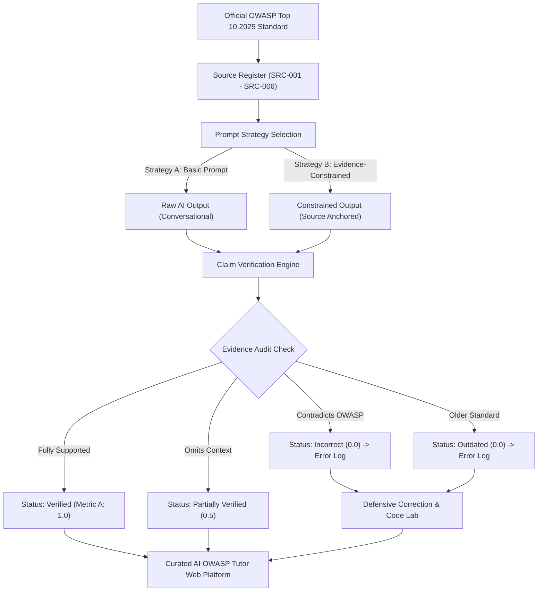

# CAPSTONE 9 — OWASP Top 10:2025 Study Guide
## Comprehensive Student Guide, Architecture Diagrams & Defense Reference

---

### 1. Conceptual Diagrams

#### A. AI Verification Loop Architecture


#### B. Vulnerability vs. Defense Flow: Access Control & Injection
```mermaid
sequenceDiagram
    autonumber
    actor Attacker as Hostile Actor
    participant Client as Browser Client
    participant Server as Trusted Express Backend
    participant DB as SQL Database

    Note over Attacker,DB: INSECURE FLOW (Broken Access Control & Injection)
    Attacker->>Client: Inputs ID: '102' OR 1=1 --
    Client->>Server: GET /api/documents/102 OR 1=1
    Server->>DB: Raw Concatenation: SELECT * FROM docs WHERE id = 102 OR 1=1
    DB-->>Server: Dumps ALL documents across all users!
    Server-->>Attacker: Data Breach (HTTP 200 OK)

    Note over Attacker,DB: SECURE DEFENSIVE FLOW (Parameterized + Ownership Verification)
    Attacker->>Client: Inputs ID: '102' OR 1=1 --
    Client->>Server: GET /api/documents/102 (Cookie: session_token)
    Server->>Server: 1. Authenticate Session (req.user.id = 5)
    Server->>DB: Parameterized: SELECT * FROM docs WHERE id = $1 AND owner_id = $2; values=[102, 5]
    DB-->>Server: No matching records for User 5
    Server-->>Attacker: HTTP 404 / 403 Forbidden (Blocked)
```

---

### 2. Deep Dive: Six Core OWASP Top 10:2025 Categories

#### Category 1: A01:2025 Broken Access Control
- **Beginner Summary**: Access control is the digital security guard of an application. If an apartment building guard lets any resident walk into any apartment just because they know the room number, that is Broken Access Control.
- **Advanced Mechanics**: Failures occur when authorization checks are missing, inconsistent, or decoupled from business logic. Insecure Direct Object References (IDOR), path traversal, missing CORS origin validation, and horizontal/vertical privilege escalation are common manifestations.
- **Core Defense**: Implement role-based (RBAC) or attribute-based (ABAC) authorization on **every server-side handler**. Filter database queries by the verified session user ID (`owner_id = req.user.id`).

#### Category 2: A02:2025 Security Misconfiguration
- **Beginner Summary**: Leaving the default master key under the doormat when you move into a brand new house.
- **Advanced Mechanics**: Leaving default credentials (`admin/admin`), keeping sample apps enabled, improperly configured cloud buckets (public S3), missing security headers (`Content-Security-Policy`, `Strict-Transport-Security`), and dumping stack traces to client browsers.
- **Core Defense**: Maintain automated infrastructure-as-code hardening scripts. Disable debugging features in production environments (`NODE_ENV=production`).

#### Category 3: A03:2025 Software Supply Chain Failures
- **Beginner Summary**: Buying parts from unverified suppliers without checking whether the parts have dangerous defects or hidden tracking bugs.
- **Advanced Mechanics**: Incorporating untrusted packages, using wildcard version specs (`"dep": "*"`), unverified lockfiles, repository hijacking (typosquatting), and malicious build-time script execution (`postinstall`).
- **Core Defense**: Pin exact version numbers, commit and enforce `package-lock.json`, use `npm ci --ignore-scripts`, generate an SBOM (CycloneDX/SPDX), and scan dependencies in CI pipelines with automated vulnerability monitors.

#### Category 4: A04:2025 Cryptographic Failures
- **Beginner Summary**: Writing a secret diary in a code that is so simple anyone with a pencil can decipher it in five seconds.
- **Advanced Mechanics**: Storing passwords in plaintext or using fast general-purpose hashes (MD5, SHA-1, SHA-256), weak pseudo-random number generators, obsolete ciphers (DES/RC4), and unencrypted sensitive data in transit.
- **Core Defense**: Use **Argon2id** (memory-hard, adaptive) for user password hashing. Enforce TLS 1.3 for data in transit and AES-256-GCM / ChaCha20-Poly1305 for sensitive data at rest. Rotate encryption keys automatically.

#### Category 5: A05:2025 Injection
- **Beginner Summary**: A customer hands a restaurant waiter an order form that says: *"One burger; and also give me all the cash in the register"*, and the cashier blindly obeys the whole paper as instructions.
- **Advanced Mechanics**: Dynamic string concatenation into query interpreters (SQL, NoSQL, OS shell, LDAP). Hostile input breaks out of the data context and executes as control syntax.
- **Core Defense**: Strict parameterization (prepared statements). Input validation with allowlists. Never concatenate raw untrusted strings into command interpreters.

#### Category 6: A07:2025 Authentication Failures
- **Beginner Summary**: Letting anyone try a million keys in a padlock without ever calling the police or locking the door mechanism.
- **Advanced Mechanics**: Susceptibility to brute-force and credential stuffing, account enumeration via timing or differentiated error messages, lack of multi-factor authentication, and predictable session identifiers.
- **Core Defense**: Enforce IP and account rate limiting (e.g. 5 attempts per 15 minutes), require MFA, use constant-time comparison to prevent timing side channels, and invalidate session cookies upon logout.

---

### 3. Glossary Quick Reference

1. **Access Control**: Policy enforcement determining allowed operations per identity.
2. **Least Privilege**: Granting only the bare minimum permissions required for a role.
3. **Security Misconfiguration**: Insecure default or unhardened system parameters.
4. **Dependency**: An external software package or module imported into an application.
5. **Software Supply Chain**: The full pipeline from source dependencies to distributed binaries.
6. **Encryption**: Reversible mathematical transformation of plaintext into ciphertext using a key.
7. **Key Management**: Lifecycle generation, secure storage, access control, and rotation of keys.
8. **Injection**: Flaw where hostile data alters command or query interpreter logic.
9. **Parameterized Query**: Pre-compiled database query where parameters are bound strictly as data values.
10. **Authentication**: Rigorous verification of a claimed user or system identity.
11. **Multi-Factor Authentication (MFA)**: Verification requiring 2+ distinct factor categories (Knowledge, Possession, Inherence).
12. **Session Management**: Secure creation, handling, transmission, and invalidation of user session states.
